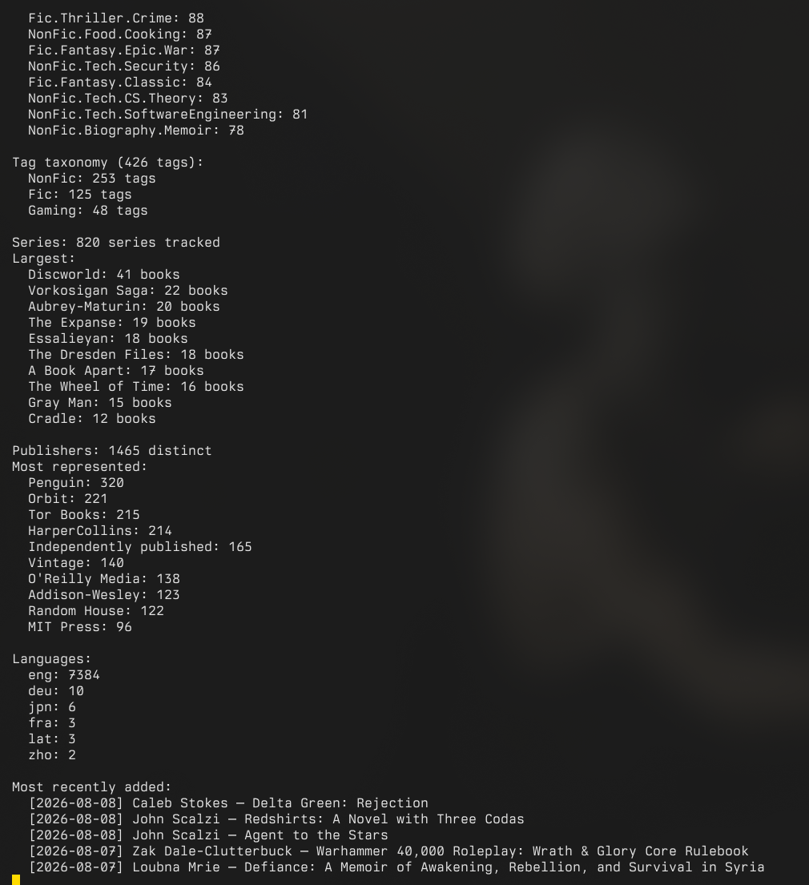

<p align="center">
  
</p>

<p align="center">
  <a href="https://www.python.org/"></a>
  <a href="https://github.com/VirInvictus/CalibreQuarry/blob/main/LICENSE"></a>
</p>

<p align="center">
  
  <!-- TODO screenshot: the curses TUI (the interactive menu) deserves a
       shot beside this one; capturing it needs a live terminal. -->
</p>

A CLI and TUI toolkit for Calibre users who treat their libraries as curated collections. 

> **Architecture Note:** CalibreQuarry acts as the frontend interface for the [cquarry](https://github.com/VirInvictus/cquarry) shared library. The database connection logic and the Calibre search grammar engine were extracted into the `cquarry` package so that other tools in the ecosystem (like Hermitage and Carrel-calibre-web) can guarantee identical behavior and query resolution.

Reads `metadata.db` directly: no `calibredb` dependency for the read surface (the `run` verbs shell out to calibredb for their parity work), no JSON intermediaries.


> **Note:** The core read/search surface is mature and stable, and is known to be fully functional on the primary development environment: **Fedora Linux 45 (Workstation Edition)**, using **Calibre 9.19** on **Python 3.14**. While it is pure Python and should be cross-platform, this specific setup is the only officially tested environment. Development is active again around the cquarry ecosystem (write verbs, batch curation, the pre-import screen); `roadmap.md` carries the current phases.

## Quick start

```bash
pip install calibrequarry
cquarry --stats --db "~/Calibre Library/metadata.db"
cquarry            # no arguments: the interactive TUI
```

## Contents

- [Why this exists](#why-this-exists)
- [How this compares](#how-this-compares)
- [Features](#features)
- [Installation](#installation) · [Requirements](#requirements)
- [Usage](#usage) · [Recipes](#recipes) · [Patch notes](patchnotes.md) · the behavioral contract is [spec.md](spec.md)
- [Sample output](#sample-output)
- [Search syntax & virtual library resolution](#search-syntax--virtual-library-resolution)
- [Troubleshooting](#troubleshooting)
- [How it reads the database](#how-it-reads-the-database)
- [Full help output](docs/cli-reference.md)
- [Companion scripts](docs/companion-scripts.md)

## Why this exists

Calibre is a good database. It is not a good reporting tool. If you maintain a large library (3000+ books) organized with virtual libraries, hierarchical tags, and series tracking, you eventually want answers to questions Calibre's UI doesn't surface well: which series have gaps, how many books are unrated, what does a given wing actually contain, and can I get a machine-readable export without running `calibredb list` through a parser script.

This tool reads the SQLite database directly in read-only mode. It ships a near-complete port of Calibre's own search engine (field prefixes like `tags:`, `author:`, `series:`, `rating:`, `pubdate:`; `vl:` cross-references; boolean and hierarchical matching), so your existing wing definitions and search habits work without being re-encoded anywhere.

## How this compares

**calibredb.** The official CLI, and the right tool for adding books, editing metadata, and administering a library. To script against a library while the GUI is open, calibredb's content-server mode is the clean route: run the server from Calibre and point calibredb at it. What calibredb doesn't ship is reporting: no series gap detection, no audit pass, no library statistics, no per-virtual-library catalog sweeps. CalibreQuarry reads the same database and adds that layer; the two compose (the catalog's `--show-id` output exists precisely for piping into `calibredb set_metadata` scripts).

**Quality Check (GUI plugin).** Excellent for hunting metadata problems from inside the Calibre interface, and the better choice if that is where you do your thinking. The audit here covers overlapping ground (duplicate detection, coverless books, metadata-quality flags); beyond that overlap its scope runs elsewhere: series gap detection across a library, filesystem-versus-database mismatches, FTS index staleness, and machine-readable output for every mode.

**Scripting it yourself.** If you have been piping `calibredb list` through parser scripts to get machine-readable answers, that pipeline is where this project started. For code, the underlying `cquarry` library (PyPI, stdlib-only) returns the same data as structured rows instead of text to parse.

## Features

| Mode | Flag | Description |
|------|------|-------------|
| **Catalog** | `--catalog` | Formatted text catalog grouped by author, with ratings and series info |
| **All wings** | `--all-wings` | Generate a separate catalog file for every virtual library; a wing that fails drops its stale file, is warned about, and fails the sweep (exit 1) |
| **All saved searches** | `--all-saved-searches` | Generate a catalog per saved search into `--outdir` (the `--all-wings` analog); each file is headed with the search's expression, zero-hit searches write nothing and say so, and a failed write drops the stale file and fails the sweep (exit 1) |
| **Full-text search** | `--fts QUERY` | Content search over Calibre's `full-text-search.db` sidecar: what the books actually say, not their metadata. Case- and accent-folded; every match names its formats; each run ends with an index-staleness summary (unless `--quiet`), and `--fts-status` reports those classes on their own |
| **Statistics** | `--stats` | Format breakdown, rating distribution, tag taxonomy, publisher counts |
| **Health digest** | `--health` | The audit's finding counts in one short screen (book issues with the top problems, duplicate groups, series gaps, conversion overrides, the metadata-quality trio, filesystem tree, FTS coverage, pending OPF sync); exit 0 unless `--fail-on-findings` turns it into a gate; composes with `--restrict` |
| **Audit** | `--audit` | Report untagged, unrated, coverless, low-resolution-cover and cover-file-missing books; deprecated-format-only and duplicate books; detect series gaps; list books with manual conversion overrides and pending OPF sync; flag invalid uuids, sentinel pubdates, and non-ISO-639-2 language values (the metadata-quality rows, advisory); and audit the filesystem against the database (missing book dirs and format files, extra/unknown files, extra covers, orphan book/author dirs, malformed paths; root dot-entries and workspace docs whitelisted) |
| **Identifierless** | `--identifierless` | Books with no identifiers (id and title): the curation queue for Calibre-Companion-style lookups |
| **Recent** | `--recent N` | Show the N most recently added books (default: 20; `--format json` emits the slim rows) |
| **Series** | `--series` | List all series with completeness status and gap detection |
| **Analytics** | `--analytics {author,pace,tags,genres,overlap,reading}` | Per-author breakdowns, reading-pace trend, tag-taxonomy tree, genre share breakdown (`--genre-depth N` descends the tag hierarchy), Wing-overlap analysis, and reading analytics (status funnel in the column's enum order, recent finishes, days-from-added-to-finished; strictly read-only) |
| Pace granularity | `--pace-granularity {month,year}` | Bucket size for `--analytics pace` (default: month) |
| Author details | `--show-author-details` | With `--catalog`/`--all-wings`/`--export`/`--search`: append each author's sort key and link URL |
| **Export** | `--export` | Full library export to JSON, CSV, or an AI-readable flat format (includes native page counts) |
| **LibraryThing** | `--exportlt` | Export library to LibraryThing formatted CSVs (can be combined with `--search`) |
| **Annotations** | `--export-annotations` | Dump e-reader highlights, bookmarks, and notes as JSON (scope to one book with `--id`) |
| **Set title** | `--set-title BOOK_ID TITLE` | Rename a book through cquarry's opt-in write module (trigger-safe; refreshes the sort key and queues an OPF regeneration). Close Calibre first |
| **Write verbs** | `--set-authors`, `--set-rating`, `--set-comments` / `--clear-comments`, `--set-column` / `--clear-column`, `--remove-book [--confirm-remove]` | Core opt-in write surface via cquarry ≥1.5: authors (author_sort recomputed), ratings (0–5), comments HTML, generic custom columns (enum-validated, non-editable refused) and guarded book removal (dry-run by default) |
| **Curation verbs** | `--rename-entity KIND OLD NEW`, `--set-author-sort BOOK SORT`, `--set-title-sort BOOK SORT` | Rename a tag/author/series/publisher everywhere (a rename into an existing name merges the two); verbatim sort overrides that a later `--set-authors` / `--set-title` deliberately recomputes over |
| **Write verbs, expanded** | `--add-tag` / `--remove-tag`, `--set-identifier` / `--clear-identifier`, `--set-series` (+ `--series-index`) / `--clear-series`, `--set-publisher` / `--clear-publisher`, `--set-languages` / `--clear-languages`, `--add-format` / `--remove-format`, `--set-cover`, `--set-pubdate` / `--clear-pubdate` | Full coverage of cquarry ≥1.5's write module: tags (orphaned rows pruned), identifier EAV upserts, series assignment with index, publisher, language lists (canonicalized `English` → `eng`), format registration/removal, and the has-cover flag. All queue OPF regeneration via `metadata_dirtied` |
| **Run verbs (Phase 17)** | `run phase1 DIR`, `run sign --manifest F`, `run phase2 --manifest F --backup-dir D`, `run phase3 --manifest F [--answer-file A]` | The acquisition pathway as commands: phase 1 vets a downloads directory into an `acquisition-manifest/1` manifest (duplicate screen, DRM audit, PDF/DJVU battery via `scripts/check_pdf.py`, bindery's EPUB slice; embedded-metadata stamps (filename parse as fallback) and provenance seeds for the review to correct); `run sign` seals the reviewed manifest (an HMAC over the approved set, the stamps, the provenance, the lossy flags, and the decisions; any later edit refuses to load until re-signed); phase 1 is dry against book files unless `--stamp`/`--apply-lossy`/`--quarantine` are passed (quarantine moves true DRM hits only); phase 2 imports the SIGNED, SEALED manifest as one transaction (`add_book`, `#source`/`#audience` stamped, tags+rating cleared on the imported ids, timestamped backups, metadata downloads whose failures become decisions, resumable); phase 3 refuses a live Calibre and banned answer-file columns like every other write path, and its mechanical-pass trouble fails the verb |
| **Set writes** | `--ids` / `--from-search` / `--from-untagged` / `--from-manifest` + `--batch-*` verbs, `--apply`, `--backup-dir`, `--format json` | One target set, many verbs, one transaction (Phase 16). Dry-run by default; `--apply` demands a closed Calibre and a backup of `metadata.db` outside the library directory, then commits as ONE `batch()` pass (all-or-nothing; `--commit-per-book` for very large sets). `--commit-per-book` really commits one transaction per book (a failing book rolls back alone; the report and JSON say which). `--batch-clear-rating` is legal ONLY against a valid, sealed batch manifest, and only for ids it imported (the bulk-ratings ban, mechanically enforced); empty-string values are refused; `#reading_status`/`status`/`date_read` are refused by name at every door; reporting counts applied / already-so / failed per verb, with a machine-readable JSON report that names the resolved ids |
| **Custom columns (write)** | `--add-custom-column LABEL NAME DATATYPE [--column-is-multiple]`, `--remove-custom-column LABEL` | The calibredb schema-CRUD parity verbs, over cquarry's column DDL. Dry run by default; `--apply` demands a closed Calibre and a backup outside the library. A new column sets Calibre's `update_all_last_mod_dates_on_start` (the next GUI start refreshes every book's last_modified); deletion only FLAGS the column (`mark_for_delete`) and Calibre purges the storage at its next start. `#reading_status`/`status`/`date_read` are refused by label at both doors |
| **Saved searches (write)** | `--saved-search-add NAME EXPR`, `--saved-search-delete NAME`, `--saved-search-rename OLD NEW` | Manage the saved searches Calibre's GUI reads, through cquarry's typed preference writer (one `preferences` row). Dry run by default; `--apply` demands a closed Calibre and a backup outside the library; one write per invocation (a book verb in the same invocation is refused); the rename refuses to overwrite an existing name, where upstream silently does |
| **Trash** | `--trash` | List the library's `.caltrash` entries (what `run merge` moved aside): category, book id, age, files; library-shape, so `--restrict` does not scope it |
| **Book detail** | `--book BOOK_ID[,BOOK_ID...]`, `--book --untagged` | Full dossier for one book or a comma-separated list: identifiers, format files with catalogued sizes and on-disk paths, cover, comments (HTML stripped), custom columns, annotations, per-device reading progress, plugin data, conversion overrides; publication date shown alongside the timestamps. `--book --untagged` (no ids) selects every untagged book (the phase-3 curation entry state) via cquarry's `find_untagged()` |
| **Entities** | `--entities KIND` | List `authors`/`series`/`publishers`/`tags`/`languages`/`ratings` with book counts; authors/series/publishers carry their sort and link columns |
| **Reading progress** | `--reading-progress` | Every recorded reading position across devices with progress bars, newest first |
| **Custom columns** | `--columns` | Custom-column schema: label, search location, datatype, editability, enum values |
| **Library info** | `--info` | Library dossier: identity UUID, wings with their defining expressions, saved searches, `@Name` user categories, grouped search terms, news feeds, conversion overrides, and the sync queues Calibre will consume |
| **Format stats** | `--format-stats` | Per-format book counts and total catalogued bytes |
| **Search** | `--search QUERY` | Books matching a Calibre search expression; prints to stdout, or to a file with `--output`. Grouped-search terms and `annotations:` work too |
| **Wings** | `--wings` | List all virtual libraries with book counts |
| **Tags** | `--tags` | Flat dump of every tag with its book count |
| **Version** | `--version` | Show version and exit |

### The integration verbs (Phase 19 C)

The integration verbs drive Calibre's own headless tools:
`run convert`, `run polish`, `run cover`, `run cover-source`,
`run export`, `run merge`, `run flush`, `run backfill`, and
`run backup-metadata` shell out to
`ebook-convert`, `ebook-polish`, `calibredb`, and
`fetch-ebook-metadata` over a resolved set and register the outcome
through cquarry's write module; `run restore-database` and
`run clone` manage whole databases under an explicit `--target`;
`run fts-index` queues Calibre's own extractor;
`run catalog-epub` / `run catalog-bibtex` produce catalogs through
calibredb's plugins (the library is only read); and `run customize`,
`run debug-tools`, `run device`, and `run news` need no library at all
(`run trash`, below, is the pure filesystem lifecycle). Every verb is
a dry run until `--apply`, which demands a closed Calibre and (for the
metadata-mutating verbs) a `--backup-dir` outside the library.
`run cover-source` walks every coverless book (the default target;
`--search`/`--ids` narrow it) through the cover ladder -- declared EPUB
cover, the book's own AZW3/MOBI file's embedded cover
(`ebook-meta --get-cover`), gated PDF page-1 render (a blank page 1
retries one page-2 render through the same gates), gated DJVU page-1
render, unique covered sibling, explicit `--url ID=URL` -- and its dry
run fully evaluates the
offline rungs so
the plan shows the cover each book would get; declined books are the
report's worklist, never failures. A
book that already has the requested conversion target is skipped at
plan time ("already has TARGET"; the file stands untouched), the
flush passes ids to `calibredb embed_metadata` space-separated (a
hyphen range would cover every book between its endpoints), flush
names its two empty states apart ("The OPF queue is empty" versus
"No targeted book is in the OPF queue") and reports the queue it
leaves behind after `--apply` (`queue_remaining` in the JSON form),
and the closed-Calibre pgrep guard is fail-closed: a timeout counts
as Calibre running.

```bash
# Plan conversions for a wing, then run them
cquarry run convert --search 'formats:PDF' --to EPUB --db ~/Calibre/metadata.db
cquarry run convert --search 'formats:PDF' --to EPUB --apply     --backup-dir ~/backups --db ~/Calibre/metadata.db

# Fold a duplicate into its keeper (unique formats move; the duplicate
# lands in the library's trash, recoverable by hand)
cquarry run merge --keeper 42 --duplicate 43 --apply     --backup-dir ~/backups --db ~/Calibre/metadata.db

# Regenerate embedded metadata for everything Calibre has queued
cquarry run flush --db ~/Calibre/metadata.db

# Refresh the per-book sidecar OPFs for the same queue (the headless
# form of the daemon job; --all widens to every book)
cquarry run backup-metadata --db ~/Calibre/metadata.db
cquarry run backup-metadata --all --apply --backup-dir ~/backups --db ~/Calibre/metadata.db

# Rebuild a corrupt metadata.db from the stored OPFs under an explicit
# target (an existing database there demands --force; saved searches,
# user categories, plugboards, and conversion overrides do not survive)
cquarry run restore-database --target ~/damaged-library   # dry run: the plan
cquarry run restore-database --target ~/damaged-library --apply

# Clone a library's SCHEMA into an empty folder (custom columns, virtual
# libraries, saved searches, settings; no books -- for a full copy, copy
# the folder with filesystem tools)
cquarry run clone --target ~/fresh-schema --apply

# Queue Calibre's own extractor over the FTS sidecar's dirtied queue
# (what --fts-status reports as stale); --fts-status and --enable
# are the other two doors
cquarry run fts-index --db ~/Calibre/metadata.db
cquarry run fts-index --apply --db ~/Calibre/metadata.db

# Install a plugin zip headlessly (the Bindery Repair plugin's front
# door; --list-plugins lists, and the mutators are dry-run by default
# with --apply demanding a closed Calibre)
cquarry run customize --add-plugin ~/Downloads/Bindery\ Repair.zip --apply
cquarry run customize --list-plugins

# The curated calibre-debug subset (explode/implode/diff/kepubify/
# un-kepubify/inspect-mobi; -e/--exec-file is not a verb and never will be)
cquarry run debug-tools --kepubify book.epub          # dry run: the command
cquarry run debug-tools --kepubify book.epub --apply

# The ebook-device USBMS subset (ls/df/books/cat read immediately;
# mkdir/cp/rm/touch are dry-run by default). MTP and wireless stay out.
cquarry run device --device-ls /
cquarry run device --device-cp book.epub carda:/books/ --apply

# Catalog through calibredb's own plugins (the CSV/XML half is the
# native --catalog; the extension decides the plugin and is enforced,
# because calibredb silently falls back to EPUB otherwise)
cquarry run catalog-epub --dest catalog.epub --search 'tags:Fic' --apply
# (the BIBTEX plugin only counts books with title, authors, publisher,
# and pubdate filled in; books missing any of them are silently absent
# from the .bib)
cquarry run catalog-bibtex --dest refs.bib --apply

# Review what the merges moved aside, then expire what is older than
# 14 days (the dry run is the listing)
cquarry run trash --db ~/Calibre/metadata.db
cquarry run trash --expire 14 --apply --db ~/Calibre/metadata.db

# Fetch today's news editions through Calibre's builtin recipes. The
# default batch is a curated free subset; --recipe TITLE (exact, from
# --list) overrides and --list prints every builtin recipe (1,149 on
# Calibre 9.19; the count rides the installed Calibre). Network only
# at --apply, sequential by design; editions land as <title>.epub in
# ./news/<date>/ and a re-run skips what is already on disk. News
# sites block scripted fetchers, so some recipes WILL fail: one
# report row per dead recipe, never a dead batch. The EPUBs are not
# imported -- vet the directory with run phase1 like any downloads dir
cquarry run news                                   # dry run: the plan
cquarry run news --apply
cquarry run news --recipe "BBC News" --recipe "Ars Technica" --apply
```

### The acquisition run verbs (Phase 17)

`run phase1 DIR` vets a downloads directory and emits the batch manifest;
`run sign --manifest F` seals it for phase 2 (and refuses to seal when the
approved list disagrees with the per-file verdicts: re-derive the list with
`run approve --manifest F`, the sanctioned propagation for a reviewer
verdict flip); `run phase2 --manifest F
--backup-dir D` imports the approved files as one transaction; `run
phase3 --manifest F [--answer-file A]` curates and mechanically finishes
the pass. Phase 1 seeds each file's manifest record with embedded-metadata
stamps (read through `ebook-meta`; the "Author - Title" filename parse is
the fallback when a file carries nothing readable) and filename-derived
provenance (the `#source` vocabulary value the filename's site markers
indicate: the "-- Anna's Archive" trailer, z-library.sk/1lib.sk naming,
libgen.li; since 3.66.0 a name carrying no marker seeds `Z-Lib`, per the
standing ruling); both are mechanical guesses the review step
verifies in the manifest before signing. The file-side
consents phase 1 accepts are `--stamp` (drive
stamp_pdf on PDFs whose filename parses), `--apply-lossy` (bindery's
gated content repairs), and `--quarantine` (move true DRM hits into
`_quarantine/`; without it the verdict is only recorded). `--bindery-report
FILE` also captures bindery's raw phase-1 JSON. Phase 2 stamps `#audience`
(`--audience`, default `Brandon`) and `#source` from the manifest's
provenance, and every run of it takes a timestamped backup in
`--backup-dir`. All of it needs the repository checkout (the verbs drive
`scripts/`, which the wheel does not carry).

Modifiers: `--restrict SEARCH` scopes every read mode to the books matching a search expression (or `vl:Name` for a wing): stats, audits, analytics, exports, catalogs, and full-text search all compute over the restricted set only; write verbs, the `run` verbs, and `--book`/`--id` refuse the combination, since explicit targets are not a set to narrow. `--show-tags` swaps ratings for tag display in catalogs, `--show-id` prefixes each book with its Calibre ID (useful for scripting against `calibredb set_metadata`), `--show-custom COL` loads a Calibre custom column (the display name or the `#label` both work since cquarry 1.9's dual resolution), `--primary-only` collapses multi-author entries to the first author, `--format {json,csv,ai,md}` selects the output shape for `--export` and `--search` (and emits the set writes' machine-readable report as JSON); `--catalog` and the catalog sweeps accept `md` for the Markdown shape, `--plugin-data NAME` appends a third-party plugin value (e.g. `goodreads_id`, `wordcount` from Calibre's `books_plugin_data` table) to catalog and search lines, `--output PATH` writes to a file instead of stdout (and no file output can ever be the database itself: the read surface refuses `metadata.db` and its sqlite sidecars before anything opens, and stages every file through a temp copy so a failed report never truncates), `--quiet` suppresses decorative output.

Running with no arguments launches a full-screen interactive TUI (arrow-key navigable) with a built-in scrollable output pager (supporting `/` search and `n`/`N` match jumping) or a text-based menu if `curses` is unavailable. The TUI remembers your database path between sessions, and a corrupt or foreign database at the configured path is reported in prose and re-prompted, never a traceback. Its menu covers the read modes above (minus `--identifierless`) including the Phase 19 surfaces (full-text content search, FTS index status, reading analytics, saved-search catalogs, the library health digest, each with an optional `--restrict`-style scope prompt) plus a **Write (Calibre closed)** section: an *Edit Book* submenu (title, authors, rating, tags, series, publisher, languages, identifiers, comments, custom columns, cover flag, formats, all backed by the same writeops executors as the CLI) and a guarded *Remove Book* flow (dry run first, then a double confirmation).

## Installation

```bash
pip install calibrequarry
# or
pipx install calibrequarry
# or
uv tool install calibrequarry
```

This gives you the `cquarry` command:

```bash
cquarry --catalog --db ~/Calibre/metadata.db
cquarry --stats
cquarry   # launches interactive TUI
```

Or run without installing:

```bash
PYTHONPATH=src python -m cquarry_cli --stats
```

## Requirements

Python 3.14+. Requires `cquarry`, `vir-tui`, and `tqdm` (`sqlite3`, `json`, `csv`, `argparse`, `curses`, `re`, `unicodedata`, `datetime`).

(3.14 is the tested floor, matching the development environment. The code does not lean on bleeding-edge language features, so it is likely fine on somewhat older interpreters, but only 3.14+ is supported.)

## Usage

```bash
# Build a catalog for a specific wing
cquarry --catalog --wing "The Tabletop" --primary-only --db ~/Calibre/metadata.db

# Same catalog, but showing tags instead of star ratings
cquarry --catalog --wing "The Tabletop" --show-tags --db ~/Calibre/metadata.db

# Catalog with Calibre IDs (for piping into calibredb set_metadata scripts)
cquarry --catalog --show-id --db ~/Calibre/metadata.db

# Generate catalogs for all virtual libraries at once
cquarry --all-wings --db ~/Calibre/metadata.db --outdir ~/docs/catalogs

# Library statistics
cquarry --stats --db ~/Calibre/metadata.db

# Audit: find unrated books, missing tags, series gaps
cquarry --audit --db ~/Calibre/metadata.db --output audit.csv

# Rename a book in place (writes via cquarry's WritableCalibreDB; queues an
# OPF regeneration so Calibre picks the change up on its next startup)
cquarry --set-title 42 "Dune Messiah" --db ~/Calibre/metadata.db

# Set write: clear tags and set a column on every untagged book. Dry-runs
# first (shows the resolved ids and planned verbs), then --apply commits the
# whole pass as one transaction after backing metadata.db up outside the
# library (Calibre must be closed)
cquarry --from-untagged --batch-clear-tags --batch-set-column '#audience' Brandon \
    --db ~/Calibre/metadata.db
cquarry --from-untagged --batch-clear-tags --batch-set-column '#audience' Brandon \
    --apply --backup-dir ~/backups --db ~/Calibre/metadata.db

# Recently added books
cquarry --recent 10 --db ~/Calibre/metadata.db

# Series completeness and gap detection
cquarry --series --db ~/Calibre/metadata.db

# Extended analytics: per-author stats, reading pace, tag tree, genre
# shares, wing overlap
cquarry --analytics author --db ~/Calibre/metadata.db
cquarry --analytics pace --db ~/Calibre/metadata.db
cquarry --analytics genres --db ~/Calibre/metadata.db
cquarry --analytics genres --genre-depth 2 --db ~/Calibre/metadata.db

# Reading analytics: the status funnel, recent finishes, days-to-read
# (strictly read-only; the #reading_status write ban is untouched)
cquarry --analytics reading --db ~/Calibre/metadata.db

# Full-text content search: which books actually discuss something
# (needs Calibre's FTS index; every run ends with an index-staleness
# summary, and --fts-status prints just that)
cquarry --fts "the spice must flow" --db ~/Calibre/metadata.db
cquarry --fts-status --db ~/Calibre/metadata.db

# Scope any read mode to a wing or expression with --restrict
cquarry --stats --restrict "vl:The Tabletop" --db ~/Calibre/metadata.db
cquarry --audit --restrict "tags:Fic.SciFi" --output scifi_audit.csv \
    --db ~/Calibre/metadata.db

# One catalog per saved search
cquarry --all-saved-searches --outdir ~/docs/catalogs --db ~/Calibre/metadata.db

# Export full library to JSON (or CSV, or an AI-readable flat format)
cquarry --export --db ~/Calibre/metadata.db --format json --output library.json

# Search with a Calibre expression; prints to the terminal by default
cquarry --search 'series:Mistborn and rating:>=4' --db ~/Calibre/metadata.db

# Same search as JSON, written to a file
cquarry --search 'tags:Fic.SciFi and pubdate:>2015' --format json --output recent_scifi.json

# Display a custom column alongside catalog/export output
cquarry --catalog --show-custom "Status" --db ~/Calibre/metadata.db

# List all virtual library wings with counts
cquarry --wings --db ~/Calibre/metadata.db

# Run a named saved search straight from Calibre's preferences
cquarry --search 'search:"Needs Filtering"' --db ~/Calibre/metadata.db

# Count-operator queries: books with more than two formats, or zero identifiers
cquarry --search 'formats:#>2' --db ~/Calibre/metadata.db
cquarry --search 'identifiers:#=0' --db ~/Calibre/metadata.db

# Export e-reader highlights and notes as JSON (whole library or one book)
cquarry --export-annotations --db ~/Calibre/metadata.db --output highlights.json
cquarry --export-annotations --id 42 --db ~/Calibre/metadata.db

# Show Goodreads IDs / word counts recorded by plugins next to each book
cquarry --catalog --plugin-data goodreads_id --db ~/Calibre/metadata.db

# Dump every tag with its book count (replaces `calibredb list_categories -r tags`)
cquarry --tags > ~/docs/catalogs/tags.txt

# Check version
cquarry --version
```

If `metadata.db` is in the current directory or at `~/Calibre Library/metadata.db`, the `--db` flag can be omitted. On first run you'll be prompted for the path, which is saved to `~/.config/cquarry/config.json` for future sessions. If Calibre is running and has the database locked, CalibreQuarry (cquarry-cli) will automatically read from a temporary snapshot.

## Recipes

Common questions mapped to a single command. These assume `--db` is configured (omit it after the first run). `--search` prints to the terminal; add `--output FILE` to save, or `--format json|csv|ai` to change the shape.

**Curation and triage**

```bash
# What haven't I rated yet?
cquarry --search 'rating:false'

# Unrated books in a specific genre
cquarry --search 'tags:Fic.Fantasy and rating:false'

# Books with no cover, or a cover so small it should be replaced
cquarry --search 'cover:false'
cquarry --audit                       # low_res_cover rows, plus cover_file_missing
                                      # where the database claims a cover the disk lacks

# Books I have only as PDF (conversion / re-acquisition candidates)
cquarry --search 'formats:PDF and not formats:EPUB'

# Books with no ISBN recorded
cquarry --search 'not identifiers:isbn:true'

# Everything still in a deprecated-only format, plus duplicates and series gaps
cquarry --audit --output audit.csv
```

**Discovery and reading planning**

```bash
# Top-rated science fiction
cquarry --search 'tags:Fic.SciFi and rating:5'

# Added in the last month / since a date
cquarry --search 'date:30daysago'
cquarry --search 'date:>=2026-01-01'

# Everything by an author (substring; quote names with spaces)
cquarry --search 'author:"Brandon Sanderson"'

# Which series are incomplete, and what's missing
cquarry --series

# What's actually inside a wing
cquarry --catalog --wing "Sci-Fi Wing" --output scifi.txt
```

**Exporting and feeding other tools**

```bash
# A whole wing as a compact, token-efficient list for an LLM prompt
cquarry --search 'tags:Fic.Fantasy' --format ai --output fantasy.ai.txt

# Export to CSV instead of JSON:
cquarry --export --format csv --output library.csv

# Export specifically formatted CSVs for LibraryThing, filtered to books added recently:
cquarry --search 'date:>2026-08-05' --exportlt
```

This exports `librarything_main.csv` and `librarything_read.csv` (split into chunks if necessary), stripping `0101-01-01` sentinel dates, parsing translator fields into distinct tags, and converting ISBN-10s into ISBN-13s to prevent spreadsheet tools from dropping leading zeroes.

## Sample output

### Catalog (`--catalog`)

```
Calibre Library Export: 2026-03-27 19:38 [The Tabletop]
========================================================

[Avery Alder]
-------------
  * The Quiet Year [PDF]

[Emmy Allen]
------------
  * The Gardens of Ynn [PDF]
  * The Stygian Library [PDF]

[Aaron Allston]
---------------
  * Dungeons and Dragons Rules Cyclopedia [PDF] [★★★★☆ 4.0/5]
```

### Statistics (`--stats`)

```
=== Library Statistics (3853 books) ===

Formats:
  EPUB    2571  ██████████████████████████
  PDF     1208  ████████████
  DJVU      65
  MOBI       8
  AZW3       3

Ratings:
  ★★★   (3.0)     81  █
  ★★★★  (4.0)   2031  ████████████████████████████████████████
  ★★★★★ (5.0)    135  ██
  Unrated:        1579  (41.0%)

Tag taxonomy (392 tags):
  NonFic: 276 tags
  Fic: 98 tags
  Gaming: 17 tags
```

### Series (`--series`)

```
  A Song of Ice and Fire: 5 of 5 (complete)
  Asian Saga: Chronological Order: 4 of 6 (incomplete)  ⚠ missing: 2, 3
  Aubrey-Maturin: 20 of 20 (complete)
  Discworld: 41 of 41 (complete)
  Parker: 10 of 18 (incomplete)  ⚠ missing: 8, 9, 10, 11, 12, 13, 14, 15
```

## Search Syntax & Virtual Library Resolution

CalibreQuarry's search engine lives in the `cquarry` library (`cquarry.search`) and ports Calibre's grammar and matching semantics as closely as the standard library allows. The same engine resolves Virtual Libraries (Wings) directly from the `preferences` table and powers the `--search` CLI mode, so your existing wing definitions work unchanged.

```
# Virtual Library Definitions
Fantasy Wing:    tags:"Fic.Fantasy" or tags:"Fic.Speculative.Fantasy"
The Tabletop:    tags:"Gaming.TTRPG"
Unsorted:        not (vl:"The Tabletop" or vl:"Fantasy Wing" or ...)

# CLI Search Queries
cquarry --search 'NOT(tags:Fic.Romance OR tags:Fic.Contemporary)'
cquarry --search 'tags:"Fic.Fantasy.Grimdark" AND author:"Phil Tucker"'
```

### Supported Search Features

* **Field locations**: `title`, `authors`/`author`, `author_sort`, `series`, `publisher`, `tags`/`tag`, `rating`, `formats`/`format`, `languages`/`language`, `pubdate`, `timestamp`/`date`, `last_modified`, `identifiers`/`identifier`/`isbn`, `comments`/`comment`, `cover`, `id`, `uuid`, `#custom` columns, plus `all` and `vl:`.
* **General Text Search**: An un-prefixed term (e.g., `Rice`) is matched across title, authors, series, publisher, tags, and comments.
* **Hierarchical tags**: `tags:Fic.Fantasy` matches `Fic.Fantasy` and everything below it (`Fic.Fantasy.Epic`, `Fic.Fantasy.Grimdark`, ...). Prepend `=` for an exact match: `tags:"=Fic.Fantasy"`.
* **Match kinds**: contains (default; case- and accent-insensitive), `=` exact, `~` regex, `^` accent.
* **Numbers and dates**: relational operators on numeric fields (`rating:>=4`, `id:<100`) and dates (`pubdate:>2015`, `date:>=2024-01-01`, `timestamp:30daysago`), plus Calibre 9.18's relative words (`lastmonth`, `thisyear`, `lastyear`, `13monthsago`, `2yearsago`; a spaced form only parses quoted, as in `date:"6 monthsago"`); `field:true`/`field:false` test presence/absence.
* **Boolean logic**: `AND`, `OR`, `NOT`, with implicit `AND` between space-separated terms (`tags:Fic tags:SciFi` == `tags:Fic AND tags:SciFi`), and parentheses for grouping (`(tags:Fic OR tags:NonFic) AND NOT tags:Gaming`).
* **Virtual Library Referencing**: `vl:"Wing Name"` cross-references an existing Wing (recursion is detected and reported).
* **Empty query**: an empty `--search ''` returns the whole library, matching Calibre.

#### Parity scope (deliberate deviations)

Matching is near-complete but not bit-for-bit identical to Calibre, by design: the engine is pure stdlib Python, while a few of Calibre's behaviors are tied to third-party libraries.

* `~` regex uses Python's stdlib `re`, not Calibre's `regex` module (`\X`, `VERSION1` semantics differ).
* Accent/contains folding uses `unicodedata` (NFKD), not ICU, so it is accent- and case-insensitive but not punctuation-insensitive.
* GPM templates (`@...:`) are tokenized but not evaluated. Saved-search references (`search:"Name"`) ARE evaluated, interpolated from Calibre's `preferences` table (cquarry 1.1).
* `tags:` is **anchored-hierarchical** (matches `Foo` and `Foo.*`), where Calibre's raw default is an unanchored substring. This is intentional and is what curated dotted taxonomies want; use `=` for strict exact.

### Custom columns

Custom columns are referred to by **two different names**, which is easy to trip over:

| Where | Which name | Example |
|-------|-----------|---------|
| `--show-custom` | the column's **display name** (what you see in Calibre) or its `#label`; both resolve since cquarry 1.9 | `--show-custom "Status"` or `--show-custom "#reading_status"` |
| `--search` (the `#` prefix) | the column's **lookup name** (label), prefixed with `#` | `--search '#reading_status:Read'` |

These two names are often different (display "Status", lookup `reading_status`). In Calibre, the lookup name is the one shown in *Preferences → Add your own columns* under "Lookup name"; the `#` search prefix always uses that one. Since cquarry 1.9 the two are bridged: `--show-custom` resolves the display name, the bare label, or the `#label` form (an exact display name wins if a bare key is ambiguous), and a "not found" error lists every column as `name (#label)`.

**Watch the contains-vs-exact trap on enumerations.** A custom search is a substring match by default, so `#reading_status:Read` also matches `Reading` and `To Read` (both contain "read"). For the exact value, use `=`: `#reading_status:=Read`. Quote values with spaces: `#reading_status:"=To Read"`.

### Quote Handling (`"` and `'`)

When running searches via the command line with `--search`, you must navigate your shell's quote-escaping rules. Items can be explicitly `""`'d or written unquoted (if they do not contain spaces).

1. **Wrap the entire query in single quotes (`'`)**: This prevents your bash/zsh shell from trying to interpret spaces or special characters.
2. **Use double quotes (`"`) inside the query**: Use double quotes around tag names, author names, or virtual library names if they contain spaces.

**Good Examples:**
```bash
cquarry --search 'NOT(tags:Fic.Romance OR tags:Fic.Contemporary)'
cquarry --search 'tags:"Fic.Fantasy.Grimdark" AND author:"Phil Tucker"'
cquarry --search "author:Anne Rice"  # Handled natively as author:Anne AND Rice
```

**What to Avoid:**
* Unquoted spaces will break your shell command: `cquarry --search tags:Fic OR tags:SciFi` (Your shell thinks `OR` is a separate argument; instead use `--search 'tags:Fic OR tags:SciFi'`).
* Mismatched quotes will cause parsing errors: `cquarry --search "tags:'Fic.SciFi'"` (Calibre expects double quotes `"` internally, not single quotes).

### Automated Test Suite

The whole suite runs without a Calibre library (stdlib `unittest`; 1,420 tests across 40 files as of 3.96.1):

- **Modes and renderers** (`tests/test_modes.py`, `tests/test_read_modes.py`, `tests/test_book_json.py`): catalog-mode cache isolation, output-directory creation and wing-filename uniqueness, the audit's cover checks, the read-mode renderers, and the machine-readable `--book --format json` dossier, all against a temporary database.
- **Search and scoping** (`tests/test_restrict.py`): the `--restrict` view (book-row scoping, recounted aggregations, per-book getters, write-verb and run-verb refusals) and its mode-level composition.
- **Analytics** (`tests/test_analytics_genres.py`, `tests/test_reading_analytics.py`): the genre share renderer and the reading-era split.
- **The acquisition pathway** (`tests/test_run.py`, `tests/test_manifest.py`, `tests/test_instruments.py`): the three run verbs end to end with their subprocess seams mocked at the instrument boundary (plus contract tests that drive the real `scripts/` instruments), the manifest schema/seal/decisions taxonomy, and the phase-1 battery (DRM verdicts, PDF battery, duplicate screen, provenance seeding, lossy mirroring, manifest-name collisions).
- **Integrations** (`tests/test_integrate.py`, `tests/test_fts.py`, `tests/test_tree_audit.py`, `tests/test_all_saved_searches.py`): the run convert/polish/cover/export/merge/flush/backfill verbs' plans and guards, the `--fts` content search and FTS staleness report, the CQ-native tree audit, and the saved-search sweep.
- **Write flows** (`tests/test_write_flow.py`, `tests/test_write_expand.py`, `tests/test_write_reporting.py`, `tests/test_set_writes.py`, `tests/test_dests.py`, `tests/test_flag_coverage.py`): the write verbs against a temporary database, including batch all-or-nothing rollback, honest applied/already-so reporting, the set-mode sources, dry-run/apply lifecycle, manifest-only rating carve-out, and banned-label refusals, plus the dest-list module pinned against the live parser, the comments write verbs, and the catalog modifier flags.
- **Companion scripts** (`tests/test_scripts.py`, `tests/test_reconcile.py`, `tests/test_audit_drm.py`, `tests/test_audit_isbns.py`, `tests/test_truncation.py`, `tests/test_duplicates_content.py`, `tests/test_cover_aspect.py`): `compress_pdf.py` size-sync and backup guards, `spot_check.py` lints and review-ledger paths, the reconcile diff/parse logic, DRM classification, the ISBN arithmetic and verdict rules, the PDF text-layer/bloat audit, content-duplicate grouping, and the cover aspect bands.
- **Repo identity** (`tests/test_tui_degrades.py`, `tests/test_version.py`): the TUI's degrade paths and menu structure, and the version-sync set (pyproject, VERSION, code, patchnotes head, spec header, spec floor, roadmap stamp).

Run them with `PYTHONPATH=src python -m unittest discover -s tests` (the same command CI runs). The shell scripts `run_tests.sh` (every CLI mode) and `test_queries.sh` (representative `--search` queries) smoke-test against a real library.

## Troubleshooting

**A search or wing returns nothing.**
- Tags are anchored-hierarchical: `tags:Fic` matches `Fic` and `Fic.*`, but not a tag that merely contains "fic" in the middle. Use the full dotted path, or `=` for an exact leaf (`tags:"=Fic.SciFi.Cyberpunk"`).
- Check the wing name with `cquarry --wings`; names are case-sensitive and must match Calibre exactly. Quote names with spaces: `--wing "Sci-Fi Wing"`.
- Template fields (`@...:`) are tokenized but not evaluated. Saved searches (`search:"Name"`) DO work; see [Parity scope](#parity-scope-deliberate-deviations).

**"Database not found" or it points at the wrong library.**
- Pass `--db /path/to/metadata.db` (or a directory containing it). The resolved path is saved to `~/.config/cquarry/config.json`; delete that file or pass `--db` to reset it.

**The shell mangles my query.** Wrap the whole expression in single quotes and use double quotes inside: `cquarry --search 'tags:"Fic.Fantasy.Grimdark" AND author:"Phil Tucker"'`. Without single quotes, your shell treats `OR`/`AND`/parentheses as separate arguments.

**"Custom column not found" (`--show-custom`).** Any of the three forms works since cquarry 1.9 (display name `Status`, bare label `reading_status`, or `#label` `#reading_status`), and the error lists every column as `name (#label)`. The `#` search grammar has always spoken `#label`. See [Custom columns](#custom-columns).

**A `#custom` search matches too many rows.** Custom searches are substring matches, so `#reading_status:Read` also catches `Reading` and `To Read`. Use `=` for an exact value: `#reading_status:=Read`.

**Calibre is open / the database is locked.** Expected. cquarry prints a notice to stderr, reads from a temporary snapshot, and cleans it up on exit. Results reflect the last saved state.

**Boxes or stars look like garbage in the TUI.** The interface uses Unicode box-drawing and star glyphs and a 256-color terminal. If `curses` is unavailable, cquarry falls back to a plain text menu automatically; piping or redirecting output disables color.

## How it reads the database

CalibreQuarry opens `metadata.db` in read-only mode (`?mode=ro`). It never writes to the database. All data comes from standard Calibre tables: `books`, `authors`, `tags`, `series`, `ratings`, `data`, `publishers`, `languages`, `identifiers`, `comments`, and `preferences`. Custom columns are not required, but are read on demand for `--show-custom` and `#column` searches.

If Calibre is running and holds a lock on the database, CalibreQuarry copies it (along with any WAL/SHM journal files) to a temporary snapshot and reads from that. A notice is printed to stderr; the temp files are cleaned up on exit.

Calibre stores ratings on a 0–10 scale internally (where 10 = 5 stars). CalibreQuarry converts to the standard 0-5 star display automatically.

## Replacing shell-based catalog pipelines

If you previously generated catalogs through a `calibredb list → JSON → parser` pipeline, `--all-wings` replaces that entire workflow with a single command. No temp files, no intermediate JSON, no shell glue functions.

The `--show-id` flag outputs Calibre book IDs, making it straightforward to pipe results into `calibredb set_metadata` for batch operations.

## Companion scripts

The `scripts/` directory holds 17 standalone maintenance tools, run directly
with `python3` (stdlib-only plus tqdm; several of them write, deliberately
outside the package's read-only contract). Per-script documentation lives in
[docs/companion-scripts.md](docs/companion-scripts.md); the full `--help`
surface is pasted in [docs/cli-reference.md](docs/cli-reference.md).

| Script | Job | Writes? |
|---|---|---|
| `audit_conversion_overrides.py` | list per-book conversion overrides | no |
| `audit_cover_aspect.py` | flag unusual cover shapes | no |
| `audit_drm.py` | flag DRM-locked files across every format | no |
| `audit_duplicates_content.py` | find books whose text duplicates another book's | no |
| `audit_isbns.py` | check stored ISBNs against the books themselves | no |
| `audit_truncation.py` | cross-check Count Pages against the real PDFs | no |
| `check_pdf.py` | the PDF/DJVU battery | no |
| `comments_census.py` | description-field defect census | no |
| `compress_pdf.py` | shrink oversize PDFs | writes |
| `extract_stamp_evidence.py` | the stamp-research evidence feeder | no |
| `fetch_library_codes.py` | derive LCC/DDC codes from the Library of Congress | with `--apply` |
| `reconcile_file_metadata.py` | sync DB metadata into book files | with `--apply` |
| `screen_duplicate.py` | screen downloads for duplicates | no |
| `spot_check.py` | randomized quality audit, with a judgement mode | no |
| `stamp_epub.py` | pre-stamp EPUB metadata for clean imports | with `--apply` |
| `stamp_pdf.py` | pre-stamp PDF metadata for clean imports | with `--apply` |
| `validate_metadata.py` | lint database integrity | no |


## Support

If CalibreQuarry is useful to you and you'd like to chip in:

- liberapay · [liberapay.com/bdkl](https://liberapay.com/bdkl/)
- bitcoin
  ```
  bc1qkge6zr45tzqfwfmvma2ylumt6mg7wlwmhr05yv
  ```
